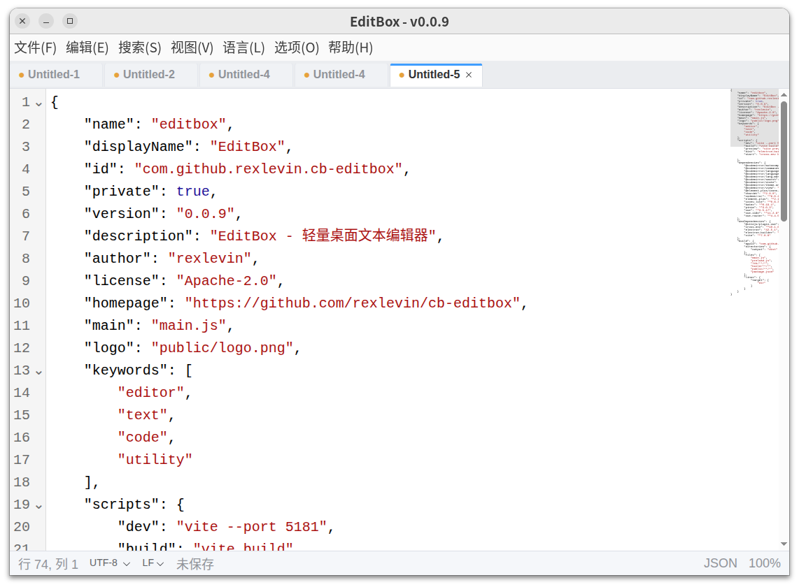
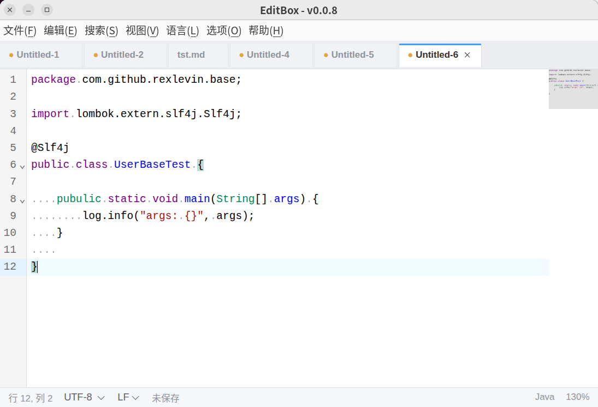
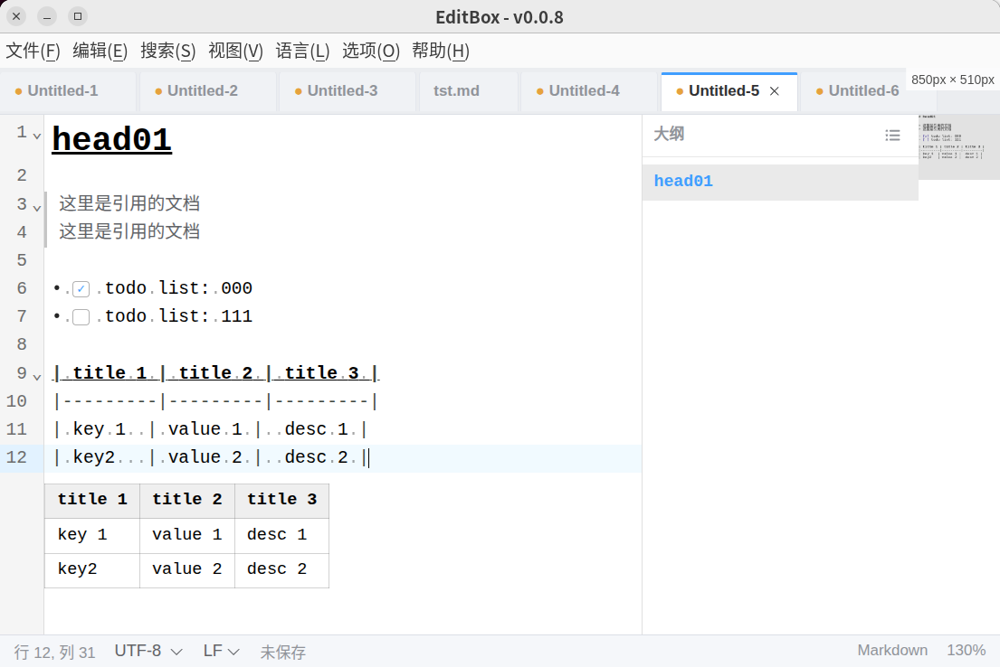

# EditBox

A lightweight desktop text and code editor for [Canbox](https://canbox-io.github.io/canbox-pages/), built on CodeMirror 6.

[简体中文文档](./README_zh-CN.md)

## Overview

EditBox is a fast, native-feeling editor focused on everyday text and code editing: multiple tabs, reliable encoding and line-ending handling, crash-safe unsaved-content recovery, syntax highlighting for 30+ languages, and Markdown-oriented tools such as live preview, an outline panel and an optional minimap. It runs as a Canbox app and shares the Canbox runtime.

## Screenshots

### Main window

Multi-tab bar at the top, the CodeMirror editing area in the center, and a status bar at the bottom showing cursor position, encoding, line endings, document language and zoom level — the encoding and line-ending controls can be switched right from the bar.


### Syntax highlighting

Automatic syntax highlighting by file name, plus manual language switching from the **Language** menu.





### Markdown live preview and outline

Markdown syntax rendered inline while the active line keeps its source, with clickable task-list checkboxes, a GFM table preview below the source, and the outline panel and minimap on the right.



### Find & replace

In-document find and replace with match-case, whole-word and regexp options.


### Dark theme

Light, dark and follow-system themes, with the editor theme switching automatically.


### Settings

A standalone settings window for language, appearance, fonts, keyboard shortcuts and about.


## Features

- **Multi-tab editing** — open many files at once; switching tabs never loses your cursor position, scroll position or in-progress edits. Tabs support a right-click context menu (close / close others / close all), switching with `Ctrl + PageUp` / `Ctrl + PageDown` and reordering with `Ctrl + Shift + PageUp` / `Ctrl + Shift + PageDown`.
- **File operations** — new, open, save, save-as and reload, plus drag-and-drop to open files and a recent-files list (last 10) in the File menu.
- **Folder workspaces** — open a folder with `Ctrl + Shift + O` to get a primary sidebar with the explorer, plus a background file index (20,000-file cap with built-in ignore rules and a truncation notice); toggle the explorer from the activity bar or with `Ctrl + Shift + E`; recent workspaces are kept in the File menu, and each workspace keeps its own tab session, so opening a workspace hides the current tabs without closing them and closing the workspace restores them exactly as they were.
- **Projects** — save the current folder as a named project from **File > Save Project...** and switch to it with `Shift + Alt + P`; the project picker supports open, delete and rename, and projects are independent of the recent-workspaces list.
- **Syntax highlighting** — 30+ languages including JavaScript, TypeScript, Python, Go, Rust, Java, C/C++, C#, HTML, CSS, Vue, JSX/TSX, JSON, XML, Markdown, SQL, Shell, YAML, Dockerfile, TOML and properties files, with manual language override from a menu grouped by first letter.
- **Quick language picker** — `Ctrl + K, M` opens a searchable language panel for the active tab; filter by name, alias or file extension and confirm with the arrow keys and Enter.
- **Find and replace** — in-document search and replace, with a floating panel pinned to the top-right of the editor.
- **Markdown live preview** — headings, bold/italic, strikethrough, inline code, links, quotes, code blocks, horizontal rules and lists are rendered inline while the cursor line keeps its source; GFM tables and KaTeX math are previewed below their source; task-list checkboxes can be clicked to toggle `- [ ]` / `- [x]`; images from absolute, relative and remote paths are rendered, with standalone images shown as source + preview. `Ctrl + Click` on a link opens it in the system browser. Enabled by default, toggled from **View > Markdown Live Preview** or `Ctrl + Shift + M`; automatically disabled for documents over 5000 lines or 3 MB with a one-time notice.
- **Markdown outline** — a heading navigation panel docked to the right of the editor (left of the minimap when it is shown). ATX and Setext headings are indented by level; clicking an entry jumps to its line and the active section is highlighted as the cursor moves. Available for Markdown documents only; collapse or expand it with the panel button or `Ctrl + K, O` (the state is remembered).
- **Minimap** — an optional code overview, off by default and enabled from **View > Show Minimap**. A custom implementation is aware of word wrapping, picks up syntax colors, and supports click/drag to scroll.
- **Encoding support** — automatic encoding detection (including BOM), one-click encoding conversion and manual switching from the status bar, and a confirmation prompt when saving would lose characters.
- **Line endings** — CRLF / LF / CR statistics with mixed-ending detection and manual conversion from the status bar.
- **Auto-save backup & crash recovery** — dirty documents are backed up automatically; after an abnormal exit, unsaved content is silently restored on the next launch, with no startup prompts. Untitled documents also keep their chosen language across sessions.
- **External change watching** — files modified on disk reload automatically when untouched, and prompt for conflict resolution when you have unsaved edits; if a file is deleted externally, you can keep the buffer or close the tab.
- **Safe close** — closing a tab or window with unsaved changes offers Save / Don't Save / Cancel.
- **Large files** — files larger than 10 MB are refused instead of opened, keeping the editor responsive.
- **Display options** — word-wrap, line-number, whitespace, line-ending and minimap toggles, tab width (2 / 4 / 8) with spaces-to-tabs and tabs-to-spaces conversion, adjustable interface and editor fonts, and light / dark / system themes (the editor theme follows automatically).
- **Interface zoom** — Ctrl + mouse wheel or `Ctrl + =` / `Ctrl + -` / `Ctrl + 0`; the zoom level, window size and position are remembered across restarts.
- **Internationalization** — Simplified Chinese and English.
- **Native menus** — File, Edit, Search, View, Language, Options and Help, with a standalone settings window (language, appearance, fonts, keyboard shortcuts, about).

## Installation

EditBox is a Canbox app and requires the [Canbox](https://canbox-io.github.io/canbox-pages/) runtime installed.

- **From the app repository**: in Canbox Manager, open **App Repository**, find EditBox in the catalog and click download; then launch it from **My Apps**.
- **Offline package**: download the canbox zip package from the [GitHub Releases](https://github.com/canbox-io/cb-editbox/releases) page, then use **Import ZIP** in Canbox Manager.

## Usage

1. Launch EditBox from Canbox Manager.
2. Create a new file (`Ctrl + N`) or open an existing one (`Ctrl + O`); you can also drag files into the window or reopen one from **File > Recent Files**.
3. Edit across tabs — each tab keeps its own undo history, cursor and scroll state. Use `Ctrl + PageUp` / `Ctrl + PageDown` to switch tabs and `Ctrl + Shift + PageUp` / `Ctrl + Shift + PageDown` to reorder them.
4. Use the **Search** menu for find (`Ctrl + F`) and replace (`Ctrl + H`).
5. Check or switch encoding and line endings from the status bar; switch syntax language from the **Language** menu or the quick picker (`Ctrl + K, M`). Toggle word wrap, line numbers, whitespace, line endings, minimap and Markdown live preview from the **View** menu; convert indentation between spaces and tabs from the **Edit** menu.
6. For Markdown documents, live preview is on by default — toggle it with `Ctrl + Shift + M`. Use the outline panel on the right to navigate headings, or collapse/expand it with `Ctrl + K, O`.
7. Open settings with `Ctrl + ,` to change language, theme, zoom, tab width, Markdown preview and fonts, and to review all keyboard shortcuts. Press `Esc` to close the settings window.

### Keyboard shortcuts

| Shortcut                                   | Action                        |
| ------------------------------------------ | ----------------------------- |
| `Ctrl + N`                                 | New file                      |
| `Ctrl + O`                                 | Open file                     |
| `Ctrl + Shift + O`                         | Open folder as workspace      |
| `Ctrl + B`                                 | Toggle primary sidebar        |
| `Ctrl + Shift + E`                         | Toggle explorer               |
| `Shift + Alt + P`                          | Open a project                |
| `Ctrl + S`                                 | Save                          |
| `Ctrl + Shift + S`                         | Save as                       |
| `Ctrl + W`                                 | Close tab                     |
| `Ctrl + PageDown` / `Ctrl + PageUp`        | Next / previous tab           |
| `Ctrl + Shift + PageDown` / `Ctrl + Shift + PageUp` | Move tab right / left |
| `Ctrl + F`                                 | Find                          |
| `Ctrl + H`                                 | Replace                       |
| `Ctrl + Z` / `Ctrl + Y`                    | Undo / Redo                   |
| `Ctrl + X` / `Ctrl + C` / `Ctrl + V`       | Cut / Copy / Paste            |
| `Ctrl + A`                                 | Select all                    |
| `Ctrl + =` / `Ctrl + -` / `Ctrl + 0`       | Zoom in / out / reset         |
| `Ctrl + Wheel`                             | Zoom                          |
| `Alt + Z`                                  | Toggle word wrap              |
| `Ctrl + Shift + M`                         | Toggle Markdown live preview  |
| `Ctrl + K`, then `M`                       | Quick language picker         |
| `Ctrl + K`, then `O`                       | Toggle Markdown outline       |
| `Ctrl + /`                                 | Toggle line comment           |
| `Alt + A`                                  | Toggle block comment          |
| `Alt + ↑` / `Alt + ↓`                      | Move line up / down           |
| `Ctrl + Alt + ↑` / `Ctrl + Alt + ↓`        | Add cursor above / below      |
| `Ctrl + Shift + K`                         | Delete line                   |
| `Ctrl + ,`                                 | Settings                      |
| `Esc`                                      | Close settings window         |
| `Ctrl + Q`                                 | Exit                          |

## Development

The app runs on the Canbox runtime via `canbox-core` injection; clone the workspace projects alongside each other.

```bash
# Install dependencies
npm install

# Start the Vite dev server (renderer, port 5181)
npm run dev

# Launch Electron with the canbox-core injection
npm run start

# Production build (renderer)
npm run build

# Produce app.asar with electron-builder
npm run dist
```

### Tech stack

Electron 42 + Vue 3 (`<script setup>`) + Pinia + Vue I18n + Vue Router + Element Plus + Vite, with CodeMirror 6 as the editor engine, chardet for encoding detection, iconv-lite for encoding conversion and KaTeX for Markdown math preview. The minimap and outline panel are custom CodeMirror extensions.

## Canbox Platform

EditBox is built on [Canbox](https://canbox-io.github.io/canbox-pages/) — a lightweight, serverless desktop app runtime.

## License

Apache License 2.0
