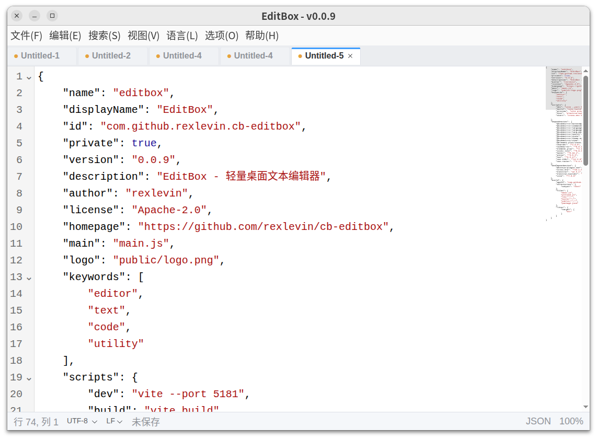
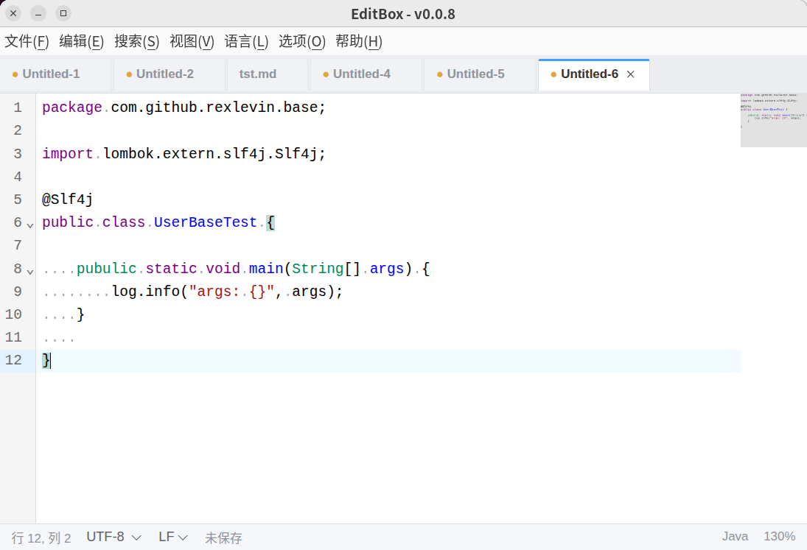
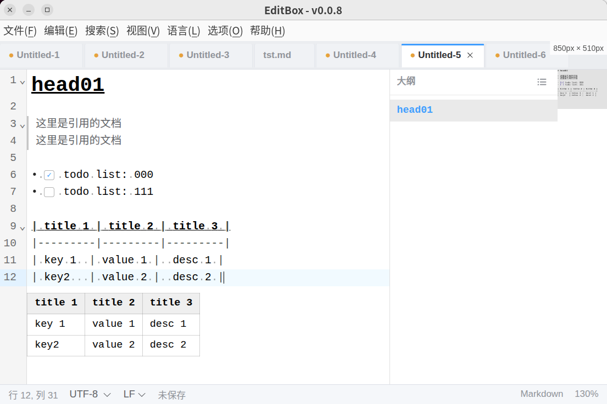

# EditBox

基于 CodeMirror 6 构建的轻量桌面文本/代码编辑器，运行于 [Canbox](https://canbox-io.github.io/canbox-pages/) 平台。

[English Documentation](./README.md)

## 简介

EditBox 是一款快速、贴近原生体验的编辑器，专注日常文本与代码编辑：多标签页、可靠的编码与换行符处理、崩溃后未保存内容安全恢复、30+ 种语言语法高亮，并提供 Markdown 实时渲染、大纲面板与可选缩略图。它作为 Canbox 应用运行，复用 Canbox 运行时环境。

## 界面截图

### 主界面

顶部为多标签栏，中间是 CodeMirror 编辑区，底部状态栏显示光标位置、编码、换行符、文档语言与缩放比例，编码与换行符可直接在状态栏切换。


### 语法高亮

按文件名自动识别语言并高亮，也可通过「语言」菜单手动切换。





### Markdown 实时渲染与大纲

Markdown 语法实时呈现且当前行保留源码，任务列表复选框可点击、GFM 表格在源码下方预览，右侧为大纲面板与缩略图。



### 查找与替换

文档内查找替换，支持区分大小写、全字匹配与正则表达式。


### 深色主题

支持浅色、深色、跟随系统三种主题，编辑器主题自动联动。


### 设置窗口

独立设置窗口，可配置语言、界面、字体，并查看全部快捷键与关于信息。


## 功能特性

- **多标签页编辑** — 可同时打开多个文件，切换标签页不会丢失光标位置、滚动位置和正在编辑的内容；标签支持右键菜单（关闭 / 关闭其他 / 全部关闭），可用 `Ctrl + PageUp` / `Ctrl + PageDown` 切换标签，用 `Ctrl + Shift + PageUp` / `Ctrl + Shift + PageDown` 调整标签顺序。
- **文件操作** — 新建、打开、保存、另存为、重新载入，支持拖拽文件到窗口打开；文件菜单提供最近打开列表（最多 10 条）。
- **文件夹工作区** — 用 `Ctrl + Shift + O` 打开文件夹，获得带文件浏览器的主侧栏与后台文件索引（2 万文件上限、内置忽略规则、截断提示）；可通过左侧活动栏按钮或 `Ctrl + Shift + E` 显示 / 隐藏文件浏览器；最近工作区保留在文件菜单中，每个工作区拥有独立的标签会话：打开工作区时当前标签被隐藏但不关闭，关闭工作区后原样恢复。
- **项目** — 通过「文件 > 保存项目...」把当前目录保存为命名项目，用 `Shift + Alt + P` 快速切换；项目选择器支持打开、删除、重命名，项目列表与最近工作区相互独立。
- **语法高亮** — 支持 JavaScript、TypeScript、Python、Go、Rust、Java、C/C++、C#、HTML、CSS、Vue、JSX/TSX、JSON、XML、Markdown、SQL、Shell、YAML、Dockerfile、TOML、Properties 等 30+ 种语言，语言菜单按首字母分组，并可手动切换。
- **语言快速选择** — `Ctrl + K, M` 打开语言搜索面板，按名称、别名或扩展名过滤，方向键选择、回车确认。
- **查找与替换** — 文档内查找和替换，浮动面板停靠在编辑器右上角。
- **Markdown 实时渲染** — 标题、粗体、斜体、删除线、行内代码、链接、引用、代码块、分隔线、列表等语法实时呈现，光标所在行保留源码；GFM 表格与 KaTeX 公式在源码下方展示预览；任务列表复选框可直接点击切换 `- [ ]` / `- [x]`；支持绝对路径、相对路径与网络图片，独立成行的图片采用「源码 + 下方预览」双显；`Ctrl + Click` 链接调用系统浏览器打开。默认开启，可通过「视图 > Markdown 实时渲染」或 `Ctrl + Shift + M` 切换；文档超过 5000 行或 3 MB 时自动关闭并提示一次。
- **Markdown 大纲** — 停靠在编辑区右侧（开启缩略图时位于缩略图左侧）的标题导航面板，提取 ATX 与 Setext 标题并按层级缩进；点击标题跳转到对应行，光标移动时高亮当前章节；仅对 Markdown 文档显示，可通过面板按钮或 `Ctrl + K, O` 折叠 / 展开（状态会记住）。
- **缩略图** — 可选的代码总览，默认关闭，通过「视图 > 显示缩略图」启用。采用自定义实现，能感知自动换行，随语法高亮着色，并支持点击 / 拖动跳转滚动。
- **编码支持** — 自动探测文件编码（含 BOM 识别），可在状态栏手动切换编码并一键转换；当保存会导致字符丢失时弹出二次确认。
- **换行符处理** — 支持 CRLF / LF / CR 统计、混行检测，并可在状态栏手动转换。
- **自动备份与崩溃恢复** — 有改动的文档自动备份；异常退出后下次启动静默恢复未保存内容，无启动弹窗打扰。未命名文档选择的语言也会随会话恢复。
- **外部变更监听** — 磁盘上的文件被修改时，未编辑的文档自动重载；有未保存改动时弹出冲突处理提示；文件被外部删除时可选择保留缓冲区或关闭标签页。
- **安全关闭** — 关闭标签或窗口时如有未保存改动，提供保存 / 不保存 / 取消选择。
- **大文件处理** — 超过 10 MB 的文件不打开，保证编辑器响应速度。
- **显示选项** — 可切换自动换行、显示行号、显示空白符、换行符与缩略图；支持 Tab 宽度（2 / 4 / 8）与空格 ↔ Tab 缩进转换；自定义界面与编辑器字体；支持浅色 / 深色 / 跟随系统主题（编辑器主题自动联动）。
- **界面缩放** — Ctrl + 鼠标滚轮或 `Ctrl + =` / `Ctrl + -` / `Ctrl + 0`；缩放比例与窗口大小、位置在重启后自动恢复。
- **国际化** — 支持简体中文和 English。
- **原生菜单** — 文件、编辑、搜索、视图、语言、选项、帮助；独立设置窗口（语言、界面、字体、快捷键、关于）。

## 安装

EditBox 是 Canbox 应用，需要先安装 [Canbox](https://canbox-io.github.io/canbox-pages/) 运行时。

- **从应用仓库安装**：打开 Canbox 管理器的「应用仓库」，在目录中找到 EditBox 并下载，随后在「我的应用」中启动。
- **离线包安装**：在 [GitHub Releases](https://github.com/canbox-io/cb-editbox/releases) 页面下载 canbox zip 安装包，在 Canbox 管理器中使用「导入 ZIP」安装。

## 使用方法

1. 从 Canbox 管理器启动 EditBox。
2. 新建文件（`Ctrl + N`）或打开已有文件（`Ctrl + O`），也可以直接把文件拖入窗口，或从「文件 > 最近打开」重新打开。
3. 在多个标签页间编辑，每个标签各自保留撤销历史、光标与滚动状态；用 `Ctrl + PageUp` / `Ctrl + PageDown` 切换标签，用 `Ctrl + Shift + PageUp` / `Ctrl + Shift + PageDown` 调整顺序。
4. 通过「搜索」菜单使用查找（`Ctrl + F`）和替换（`Ctrl + H`）。
5. 在状态栏查看或切换编码、换行符；通过「语言」菜单或快速选择面板（`Ctrl + K, M`）切换语法语言；在「视图」菜单切换自动换行、行号、空白符、换行符、缩略图与 Markdown 实时渲染；在「编辑」菜单执行空格 ↔ Tab 缩进转换。
6. 编辑 Markdown 时实时渲染默认开启，可用 `Ctrl + Shift + M` 切换；右侧大纲面板可导航标题，用 `Ctrl + K, O` 折叠 / 展开。
7. 使用 `Ctrl + ,` 打开设置，可配置语言、主题、缩放、Tab 宽度、Markdown 实时渲染与字体，并查看全部快捷键；在设置窗口按 `Esc` 关闭。

### 快捷键

| 快捷键 | 功能 |
| --- | --- |
| `Ctrl + N` | 新建文件 |
| `Ctrl + O` | 打开文件 |
| `Ctrl + Shift + O` | 打开文件夹为工作区 |
| `Ctrl + B` | 显示 / 隐藏主侧栏 |
| `Ctrl + Shift + E` | 显示 / 隐藏文件浏览器 |
| `Shift + Alt + P` | 打开项目 |
| `Ctrl + S` | 保存 |
| `Ctrl + Shift + S` | 另存为 |
| `Ctrl + W` | 关闭标签 |
| `Ctrl + PageDown` / `Ctrl + PageUp` | 下一个 / 上一个标签页 |
| `Ctrl + Shift + PageDown` / `Ctrl + Shift + PageUp` | 当前标签后移 / 前移 |
| `Ctrl + F` | 查找 |
| `Ctrl + H` | 替换 |
| `Ctrl + Z` / `Ctrl + Y` | 撤销 / 重做 |
| `Ctrl + X` / `Ctrl + C` / `Ctrl + V` | 剪切 / 复制 / 粘贴 |
| `Ctrl + A` | 全选 |
| `Ctrl + =` / `Ctrl + -` / `Ctrl + 0` | 放大 / 缩小 / 重置缩放 |
| `Ctrl + 滚轮` | 缩放界面 |
| `Alt + Z` | 切换自动换行 |
| `Ctrl + Shift + M` | 切换 Markdown 实时渲染 |
| `Ctrl + K`，然后 `M` | 语言快速选择 |
| `Ctrl + K`，然后 `O` | 折叠 / 展开 Markdown 大纲 |
| `Ctrl + /` | 切换行注释 |
| `Alt + A` | 切换块注释 |
| `Alt + ↑` / `Alt + ↓` | 当前行上移 / 下移 |
| `Ctrl + Alt + ↑` / `Ctrl + Alt + ↓` | 在上方 / 下方增加光标 |
| `Ctrl + Shift + K` | 删除当前行 |
| `Ctrl + ,` | 设置 |
| `Esc` | 关闭设置窗口 |
| `Ctrl + Q` | 退出 |

## 开发

应用通过 `canbox-core` 注入运行于 Canbox 运行时，需将相关工作区项目放在同级目录。

```bash
# 安装依赖
npm install

# 启动 Vite 开发服务器（渲染进程，端口 5181）
npm run dev

# 以 canbox-core 注入方式启动 Electron
npm run start

# 生产构建（渲染进程）
npm run build

# 使用 electron-builder 产出 app.asar
npm run dist
```

### 技术栈

Electron 42 + Vue 3（`<script setup>`）+ Pinia + Vue I18n + Vue Router + Element Plus + Vite，编辑器内核为 CodeMirror 6，编码探测使用 chardet、编码转换使用 iconv-lite、Markdown 公式预览使用 KaTeX；缩略图与大纲面板为自定义 CodeMirror 扩展。

## Canbox 平台

EditBox 构建于 [Canbox](https://canbox-io.github.io/canbox-pages/) 之上 —— 一个轻量、无服务器的桌面应用运行时。

## 开源许可

Apache License 2.0
